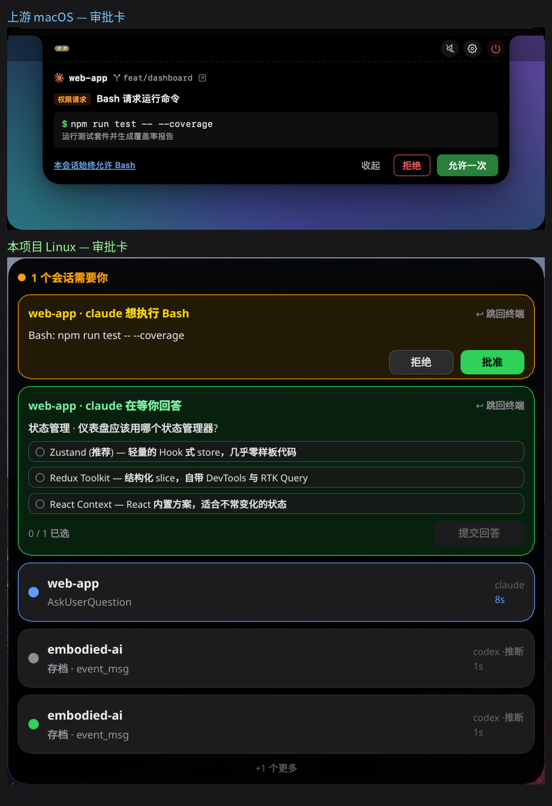
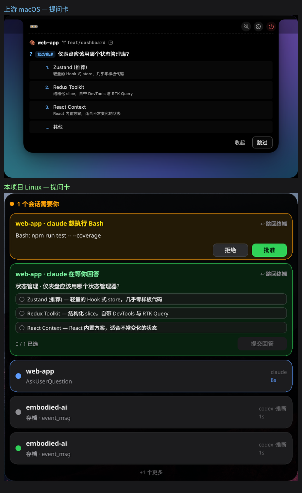

# 功能差距与路线图（2026-10-14 实测，含视觉比对）

上游 [wxtsky/CodeIsland](https://github.com/wxtsky/CodeIsland)：775 个文件，2495★，macOS 14+，Swift。
本文只讲**差距与计划**；逐项技术对照见 `与上游的差异.md`。

## 一、这次怎么比的（可复现）

1. **拿到上游真实界面**：GitHub 域名在本机被解析成 `0.0.0.0`（`raw.githubusercontent.com` 直接拒绝连接），
   走**已登录的 `gh api`** 取 `contents`，把 `docs/images/` 的 `readme-hero.png`、`readme-approval.png`、
   `readme-question.png`（及 `-zh` 版）下载到本地。上游 README 里的截图是**真实界面渲染**，不是示意图。
2. **让本项目进入同样的状态**：`scripts/hold-card.py` 用**真的桥接程序**对着**真的默认 socket** 持有一张
   审批卡和一张提问卡，于是常驻程序按真实路径 park 了两张卡。
   - 关键坑：桥接程序**把 stdin 读到 EOF 才开始转发**（它是个过滤器，不是服务器）。持有者必须
     `stdin.close()` 而**不能让进程退出** —— 进程活着，socket 才不 EOF，「agent 已走」才不会触发。
     第一版没关 stdin，于是桥接干坐着、一张卡都没发。
3. **并排拼图**：`docs/images/compare-{approval,question,overview}.png`（上游在上、本项目在下）。下面是据此得出的结论。

> 比对时的另一个自伤：清理演示脚本时写了 `pkill -f "codeisland-bridge"` 和
> `case "$c" in *hold-and-watch*)`，两者都**匹配到了我自己这条 bash 的命令行**，把自己杀了
> （exit 143/137）。判据：只认 `readlink /proc/<pid>/exe` + `argv[1]` 正好是脚本名。

## 二、视觉比对结论

**已经是同一套设计语言的**：纯黑胶囊、圆角、暗色卡片、橙=需要你 / 绿=在跑 的状态色、
标题加粗+副行灰字、副行给工具摘要。审批卡与提问卡的**信息结构一致**：标题行「项目 · 工具 · 动作」、
细节块、按钮右对齐；提问卡的**选项列表带序号/说明**、多选计数 `0/1 已选`。

**肉眼可见的差异**（按重要性排）：

| # | 差异 | 上游 | 本项目 | 影响 |
|---|---|---|---|---|
| V1 | **没有工具图标/mascot** | 每个工具一个像素风角色（`cli-icons/*.png` + `mascots/*.gif`，按状态动） | 一个纯色圆点 | 最大的一眼区别；辨识「哪个 agent」要靠读文字 |
| V2 | **卡片没有「分支名」和「项目分组」** | 标题行带 `⑂ feat/dashboard`、`#7a58`；可按项目/工具分组 | 只有项目名 | 多会话时定位变慢 |
| V3 | **卡片副行只显示一行摘要** | 多行：任务清单勾选、上一条回复（Markdown）、当前工具 | 一行 `存档 · event_msg` 或命令摘要 | 信息密度低很多 |
| V4 | **顶部没有工具条** | 左：`ALL/STATUS/AGENT` 过滤标签；右上：静音、设置、退出 | 只有一行标题 | 缺过滤与开关 |
| V5 | **卡片没有「收起」按钮** | 每卡右下「收起」，另有「跳过」 | 拒绝/批准（审批卡）、提交回答（提问卡） | 提问卡**无法跳过**（见 F3） |
| V6 | **没有耗时/完成态视觉** | 右上角 `4m/12m/1h`，完成态卡片变暗 + `已完成` | 右侧灰字时间（有），完成态无特殊样式 | 小 |
| V7 | **窗口高度明显更大**（620×607 时） | 上游 hero 面板更紧凑、信息更多 | 同类信息占用更多纵向空间 | 中 |
| V8 | **没有底部状态栏** | 底部一行：`Claude · 近5小时 输入422K 输出96.4K · 今日 …` | 无 | 依赖 F7 的用量统计 |

## 三、功能差距（按「值不值得做」排）

状态：✅ 已有 · ⚠️ 部分 · ❌ 没有

### 第一梯队：核心体验缺口

| # | 功能 | 上游行为 | 本项目 | 备注 |
|---|---|---|---|---|
| F1 | **全局热键** | `⌘⇧I` 开合、`⌘⇧A` 批准、`⌘⇧D` 拒绝，可改绑；启用后在卡上显示快捷键徽标 | ❌ | KDE 侧走 `org.kde.kglobalaccel`（**已确认本机会话总线上存在该服务**）。**这是「不用切窗口」体验的关键**：现在必须用鼠标点。 |
| F2 | **始终允许（always-allow）** | 「本会话始终允许 Bash」，回包带会话级白名单 | ❌ | Claude 的回包格式要按二进制核实（同阶段 2 的做法）。**安全敏感**，需确认是 CLI 原生支持而非我们伪造。 |
| F3 | **跳过提问** | 提问卡有「跳过」，把问题交回终端 | ❌（当前只有「提交回答」，未选满时禁用） | 与安全契约一致：跳过=沉默=交回 CLI。实现成本低，价值高。 |
| F4 | **多问题/多选提问** | 一次多问、多选（`multiSelect`） | ⚠️ 只答实测过的**单选单问**形状，其余**主动不 park** | 不是没做，是**不肯猜**（见 `docs/协议.md`）。要扩需先量真实载荷。 |

### 第二梯队：一眼看清（视觉信息量）

| # | 功能 | 上游 | 本项目 |
|---|---|---|---|
| F5 | 工具图标/mascot（含动画） | ✅ 30+ 个 | ❌ |
| F6 | 卡片上显示 git 分支/工作树 | ✅ | ❌ |
| F7 | 用量统计（5 小时/周配额、token） | ✅ | ❌ |
| F8 | 任务清单渲染成进度条 | ✅（TodoWrite / `update_plan` / `write_todos` / `todowrite`） | ⚠️ 只做到「行上报当前步骤」（`update_plan · 2/3 改判定`）；整张清单 → 进度条**未做**。解析参考上游 `AgentTaskParsing.swift`（25077 字节） |
| F9 | 回复内容 Markdown 渲染（列表/表格/代码块+复制） | ✅ | ❌ |
| F10 | 会话按项目/工具分组 | ✅ | ❌（只是平铺，最多显示 3 条 + 「+N 更多」） |

### 第三梯队：不打扰与自动化

| # | 功能 | 上游 | 本项目 |
|---|---|---|---|
| F11 | 智能抑制（正在看那个标签页就不响） | ✅ | ❌ |
| F12 | 静默时段 / 每事件 8-bit 音效 | ✅ | ❌（连声音都没有） |
| F13 | 跟进提醒（未看的批准/提问/完成） | ✅ | ❌ |
| F14 | 目录静默规则 | ✅ | ❌ |
| F15 | 锁屏/睡眠时静音 | ✅ | ❌ |
| F16 | YOLO/Turbo 模式自动放行 | ✅ | ❌ |
| F17 | 完成态「瞥一眼」点 | ✅ | ❌ |

### 第四梯队：超出本机（上游的重头戏，本项目按范围排除）

| # | 功能 | 本项目 |
|---|---|---|
| F18 | SSH 远程主机会话 | ❌ 未开始（用户已定：很成熟之后再做） |
| F19 | iPhone/Apple Watch/ESP32 buddy | ❌ 不在范围 |
| F20 | 推送渠道（Bark/ntfy/钉钉/飞书/企微/Slack/Telegram） | ❌ 未开始（倾向 ntfy） |
| F21 | webhook 转发原始事件 | ❌ |
| F22 | 多语言 UI（上游 7 种） | ❌ 中文硬编码 |
| F23 | 自动更新（Sparkle） | ❌ 未定 |
| F24 | 30+ CLI 适配 | ⚠️ 3 家（claude/codex/pi），但**事件名映射表已转写** |
| F25 | 终端标签页级跳转 | ⚠️ 只做窗口级（标签页级实测放弃，见差异文档） |
| F26 | 设置界面 | ❌ 全靠环境变量 |
| F27 | Claude Desktop Cowork 集成 | ❌ |
| F28 | 额外配置目录（第二份 `CLAUDE_CONFIG_DIR`/`CODEX_HOME`） | ❌ 只读默认目录（见 `discover.rs` 的注释，已知简化） |
| F29 | 诊断导出 | ❌ |

## 四、建议的推进顺序

**先做 F1 + F3**（全局热键 + 跳过提问）：
- 都是「补齐核心交互」而不是加新概念，改动集中在 `shell/` 与一次协议小扩展；
- F3 天然符合安全契约（跳过=沉默），且让提问卡不再是死胡同；
- F1 是上游「不用切窗口」卖点的一半，缺了它现在的交互必须动鼠标。

**再做 F2**（始终允许）：安全敏感，先按阶段 2 的方法**逐字节核实 Claude 的回包格式**，
确认那是 CLI 原生能力再动手；核实不出就明确记为「不做」，而不是猜。

**然后 F5 + F7**（图标 + 用量）：这两项是**视觉差异里最大的一眼区别**（V1、V8），
图标要引入一套资源（可从上游 MIT 资源取，注意许可证），用量要新增对存档/`stats` 的读取。

**最后 F8 + F9 + F10**（任务清单、Markdown 回复、分组）：都依赖「拿到更多事件内容」，
要先量清三家 CLI 各自把任务清单和回复放在哪个字段 —— 不猜。

## 五、明确不做的

- F18–F21（远程/buddy/推送/webhook）：按用户决定，等本项目成熟。
- F25 标签页级跳转：实测 Konsole 的 API 会谎报成功，不做（已有记录）。
- F26 设置界面：在功能面稳定前，环境变量够用；过早做会锁死配置形状。
